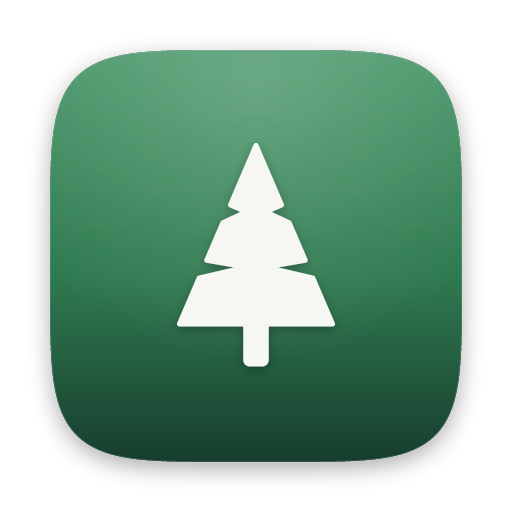

# Koi Human Interface Guidelines

The design system (`de/design`), the shell (`de/shell`) and the window
manager follow these values. The GRUB theme (Phase 2) uses the palette
and type from here. Screenshots of the shell are in
`docs/design/img/shell-*.png`; they are the render test's, so
`just shell-test` regenerates them.

## Principles

1. **Calm.** Few colors, generous space, motion that settles and doesn't
   bounce for attention.
2. **Consistent.** Every surface comes from the shared design-system
   module; no app styles its own controls.
3. **Ours.** Original art and permissively licensed fonts and symbols
   only. Nothing from Apple, and no upstream Linux branding.
4. **Invisible plumbing.** The user never sees the Linux underneath: no
   terminal flashes, unthemed dialogs, or raw error text.

## Foundations

Implemented in `de/design` (the `Fern.Design` QML module). Components
read every value from `Theme`; none writes a colour or size literal.

**Colour.** Light and dark palettes are built from the brand colours
(Brand, below). The tokens are:

| Token | Light | Dark |
|---|---|---|
| window | Paper `#F6F7F3` | `#1A1F1C` |
| sidebar | `#ECEFE9` | `#202622` |
| surface | `#FFFFFF` | `#232A25` |
| text | Ink `#101512` | `#F2F4F0` |
| secondaryText | `#5A625D` | `#AEB6B1` |
| separator | Ink 10 % | white 10 % |
| fill / hover / pressed | Ink 6 / 9 / 13 % | white 9 / 13 / 18 % |
| destructive | `#B3261E` | `#FF8A7A` |

**Accent.** The accent presets are fern (the default), blue, purple,
pink, orange, amber and graphite. Each preset has three values: a fill
for light mode, which carries white text; a fill for dark mode, which
carries Ink text; and a darker shade for accent-coloured text in light
mode. A custom `#rrggbb` accent is lightened for dark mode. "From
wallpaper" will extract the accent from the wallpaper in Phase 7; until
then it is Fern green.

The tests in `de/design/tests/tst_theme.qml` check WCAG AA (4.5:1) for
every text and background pair:

- text, secondary text, accent text and destructive text on window,
  surface and sidebar, in both modes;
- the label on every accent, in both modes;
- text on every material, laid over pure white and pure black.

**Type.** Inter at these sizes:

| Style | Size and weight |
|---|---|
| largeTitle | 26 Bold |
| title1 | 22 Bold |
| title2 | 17 SemiBold |
| title3 | 15 SemiBold |
| headline | 13 SemiBold |
| body | 13 |
| callout | 12 |
| subheadline | 11 |
| footnote | 10 |

The appearance setting `text_size` scales every size: small ×0.92,
default, large ×1.12, larger ×1.25.

**Space and shape.** Spacing follows a 4 px grid (`Theme.space(n)`).

| Radius | Value |
|---|---|
| small (menu rows) | 5 |
| control | 7 |
| menu | 9 |
| card | 10 |
| window | 12 |
| popover | 14 |
| panel, dock, HUD | 18 |

Controls are 28 px tall, and 34 px in the large size.

**Symbols.** UI glyphs are Lucide (ISC). The design system's
`image://symbol/NAME?color=` provider recolours them
(assets/symbols/README.md).

**Motion.** All motion uses critically damped springs, the same three
the compositor uses:

| Spring | Response | Settles in | For |
|---|---|---|---|
| snappy | 0.25 s | 368 ms | hover, toggles, segments |
| smooth | 0.42 s | 617 ms | panels, the dock sliding, banners |
| gentle | 0.6 s | 882 ms | large moves, wallpaper crossfades |

In QML a spring is
`NumberAnimation { duration: Theme.smooth; easing: Motion.curve }`. With
reduce motion on, every duration becomes 0: things change in place, and
only fades remain.

**Materials.** A material is a tint over the compositor's background
blur, plus a light inner edge and a faint outline. The blur's dither
supplies the grain. A shell surface asks for its blur with
`fern_shell_v1.set_blur`.

| Material | Light | Dark |
|---|---|---|
| menubar | Paper 62 % | `#141815` 68 % |
| dock | white 42 % | `#1C221E` 52 % |
| popover | Paper 80 % | `#1E2420` 80 % |
| menu | Paper 86 % | `#1E2420` 84 % |
| HUD | Ink 78 % | Ink 78 % |
| sidebar | `#ECEFE9` 72 % | `#1A1F1C` 70 % |
| sheet | Paper 94 % | `#1E2420` 92 % |

With reduce transparency on, every tint is opaque.

## Controls

These are in `Fern.Design`, built on Qt Quick Templates, and covered by
`tst_controls.qml`:

- **Button.** Kinds: primary (accent; one per view), secondary and plain.
  It can carry an optional symbol.
- **Toggle.** A 38×22 switch whose knob springs across.
- **Checkbox.**
- **SegmentedControl.** The selection slides between segments; arrow keys
  move it.
- **Slider.**
- **TextField** and **SearchField.** SearchField has the search symbol
  and a clear button.
- **MenuItem** and **MenuSeparator.**
- **Label.** Text in the type scale.
- **Symbol.**
- **Material.**

Focus shows as a 3 px accent ring at 45 %. Still to come, with the apps
that need them (Phase 8 and later): stepper, popover and sheet controls,
alert, sidebar, toolbar with unified titlebar, table, outline view and
column view.

## Shell

The shell is `de/shell`, fern-shell. Each part is a layer surface
(docs/protocols/shell.md).

**Menu bar.** 28 px tall, full width, in the menubar material, or solid
when `menubar.translucent` is off.

- Left: the Fern mark (the Fern menu), then the active app's name in
  bold, then its menus.
- Right: Wi-Fi and sound (when available), the control center, Search,
  then the clock. The clock shows the date, and seconds or a 24-hour
  time if those settings are on. Clicking it opens the notifications.

Menus drop down 2 px below the bar, in the menu material, with radius 9
and 24 px rows. Moving the pointer along the bar while a menu is open
opens the next one.

**Dock.** It sits on the bottom, left or right edge, 6 px from the edge.

- Icons are 52 px by default (32–96). The pad around them is 14 % of the
  icon size, with 6 px between icons.
- Magnification is a cosine bump about three icons wide, growing to
  `magnified_size` (76 px by default).
- Order: pinned apps, then running apps that aren't pinned, then up to
  three recent apps, then a divider, then Downloads and Trash.
- A running app has a 4 px dot on the edge side. A launching app bounces
  until its window appears (at most 10 s).
- The app's name appears above its icon on hover.
- Right-click an icon for its menu: the app's windows, Open,
  Keep in Dock or Remove from Dock, and Quit.
- Drag a pinned app to reorder it.
- With autohide, the dock slides out of sight on the smooth spring, and a
  3 px strip at the screen edge brings it back.
- Until the adaptive icons arrive (Phase 7), an app without an icon gets
  a tile: a gradient picked from its id, with its initial.

**Search** (Super+Space). A 640 px popover 18 % down the screen, with a
44 px field in Inter 20. Results come in this order:

1. a sum or unit conversion (Return copies it);
2. apps;
3. actions: dark or light mode, Do Not Disturb, About, restart and shut
   down.

Arrow keys move through the results, Return opens one and Escape closes
Search.

**Notifications.**

- Banners are 340 px wide, at the top right, 6 px below the menu bar.
  They slide in on the smooth spring and stay for `banner_seconds`, or
  until dismissed if the app asks for that. They stay while the pointer
  is over them.
- Do Not Disturb sends new notifications straight to the history.
  Critical ones still show.
- The history is a full-height panel on the right, with Clear All.

**Control center.** A 324 px popover with a radius of 18.

- Four 2×2 tiles: Wi-Fi, Bluetooth, Do Not Disturb and Appearance. Each
  is a round 30 px symbol (the accent when on), a title and a status. A
  tile with nothing behind it says "Not available" and does nothing.
- Then the Sound and Display sliders, then what is playing (MPRIS).

**Volume HUD.** A 180 px HUD-material square 140 px above the bottom.
It shows a symbol and a 16-step level, and fades after 1.5 s.

**Wallpaper.** The compositor draws the wallpaper. A change crossfades
over 0.88 s on the gentle curve. In dark mode the shell shows the dark
partner, which by default is Grove at night.

## Windows *(Phase 5)*

Traffic-light buttons top-left (close / minimize / zoom), glyphs on hover,
dimmed when inactive; shadows tied to focus.

| Element | Spec |
|---|---|
| Titlebar | 28 px, part of the window's rounded frame (top corners rounded, content below keeps the bottom ones); active #EAECE7, inactive #F3F4F1 |
| Title | Inter SemiBold 13 px, centred, ellipsis when it would reach the lights (76 px inset each side) |
| Lights | 12 px circles, first centre 20 px from the left edge, 20 px apart; close #EE5D50, minimize #F2B53A, zoom #3DB862; inactive and not hovered #D3D6D0 |
| Glyphs | × − + drawn on hover over the lights, dark at 60 % |
| Hit areas | each light: its circle plus 2 px; resize: 6 px outside the frame, 14 px corner squares |
| Behaviour | a light acts on release over the same light; titlebar drag moves; double-click zooms; edges resize |

**Tiling.** Halves and quarters of the work area with 8 px gaps around
and between them. Snap zones: 4 px from the left or right edge (halves),
96 px from a corner along an edge (quarters), the top edge (fill). The
preview is Leaf #7CC48A at 25 % with the window radius, under the window
being dragged, and moves on the `smooth` spring when the window lands.
Keyboard: Super+Left / Super+Right halves, Super+Up fill (from a half:
the top quarter), Super+Down back to the window's own frame (from a half:
the bottom quarter).

**Spaces.** Switching slides windows by one screen width on the `smooth`
spring, the wallpaper fixed. Ctrl+Super+Left/Right switch;
Ctrl+Super+Shift+Left/Right carry the focused window. Fullscreen windows
get their own Space, square corners, no shadow; Ctrl+Super+F toggles.

**Minimize.** The window shrinks (uniformly) and fades into its dock icon
on the `gentle` spring, or towards the bottom middle of the screen when no
dock shows it, and comes back the same way. Super+M minimizes.

**Overview.** Ink at 45 % dims the desktop; windows tile on the `smooth`
spring with 16 px around each and their title (Inter SemiBold 13, Paper)
below. The Spaces strip: thumbnails one eighth of the screen high, 24 px
apart, 8 px radius, the current one ringed in Leaf (3 px), labels in
Inter 12; the + button is Paper at 20 %. The highlighted window has a
5 px Leaf ring. Ctrl+Super+Up.

**App switcher.** A HUD panel (Ink at 85 %, radius 18, 18 px padding) of
136 x 128 cells, the picked one Paper at 18 % with radius 12; app names
in Inter 12. Super+Tab, Super+Shift+Tab; Super+` cycles an app's windows.

## Brand

The Fern logo is a simple pine tree: a soft cone with two branch cuts
reaching in towards the trunk, on a forest-green plate. Generated by `tools/brand/gen-logo.py`
(`just logo`); never edit the SVGs by hand.

| Asset | Use |
|---|---|
| `assets/brand/fern-icon.svg` | full-colour icon: About, installer, docs, app-store style contexts |
| `assets/brand/fern-mark.svg` | single colour (`currentColor`): menu bar Fern menu, boot splash, GRUB theme |
| `assets/brand/fern-icon-glass.svg` | clear glass on a transparent background: over wallpapers and translucent surfaces; the reference look for the "Clear" icon mode |

**Glass.** The glass plate is mostly transparent (a white body at 7-26%
opacity, brighter toward the light), with a rim light on the top-left and
bottom-right edges, a top sheen, a soft inner band for thickness, and a
faint dark hairline outside the rim so the edge holds on white. The
foreground is white with a soft shadow. A standalone SVG cannot blur its
backdrop; on screen the compositor supplies the backdrop blur.

**Squircle.** Every icon plate is the superellipse
`|x/a|^5 + |y/a|^5 = 1` (continuous curvature, no visible join where the
edge meets the corner). The plate is 824 units on a 1024 canvas, leaving
room for the shadow (y +14, blur 22, 32% black). This definition moves to
`de/design` in Phase 6 and both must stay identical.

**Mark grid.** The mark is drawn on a 64-unit canvas (the tree spans
x 14-50, y 6-58) and the icons scale that same drawing up, so the menu-bar
mark at 16 px and the 1024 px icon are one shape. A thin round-joined
stroke of the fill colour softens every corner.

**Logo palette** (starting point for the design-system palette, Phase 6):

| Name | Hex | Role | Contrast |
|---|---|---|---|
| Ink | `#101512` | text; dark-mode background | 17.1:1 on Paper |
| Forest | `#173D2E` | brand colour: the logo, the icon plate's foot | 11.2:1 on Paper |
| Pine | `#245C43` | links and accent text in light mode | 7.3:1 on Paper |
| Fern | `#2F7A50` | default accent: buttons, toggles, selection | white on it 5.2:1 |
| Leaf | `#7CC48A` | accent in dark mode | 8.9:1 on Ink |
| Moss | `#E3F0E4` | tinted surfaces: sidebars, selected rows | |
| Paper | `#F6F7F3` | light-mode background, a warm off-white | |

The default wallpaper, **Grove** (`assets/wallpapers/gen-wallpapers.py`),
aims for a photograph, not a flat drawing: ridge behind ridge of spruce
forest at dawn fading into textured fog, every tree a ragged silhouette of
drooping branch tiers, each ridge softened by distance, light shafts from a
hazy sun, grain and a vignette.

## Boot menu

Our GRUB gfxmenu theme (`boot/grub-theme/`, `just grub-preview` boots it
in QEMU and screenshots it), on the blurred Grove wallpaper: the glass logo
and name; a "Choose a system to start" heading; the systems on a frosted
panel, Inter 20, the selected one on a green bar (a thin scrollbar appears
when the list is longer than the panel); under it a countdown bar that
empties, reading "Starting the selected system in N seconds"; and a line
of the keys GRUB understands (arrows, Enter, E to edit an entry, C for its
command line). GRUB's own title and help text never appear. With the
default menu style ("hidden") none of this shows unless Shift is held.
