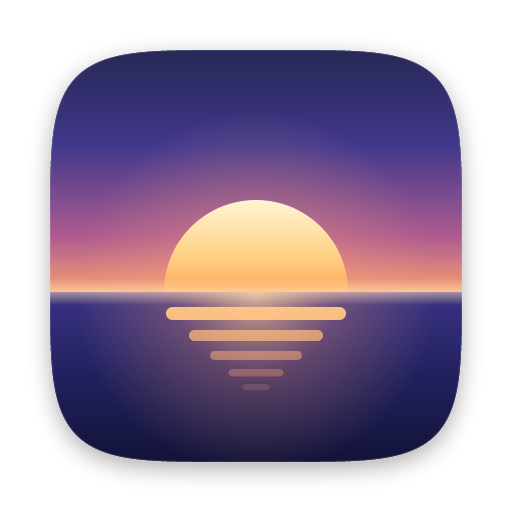
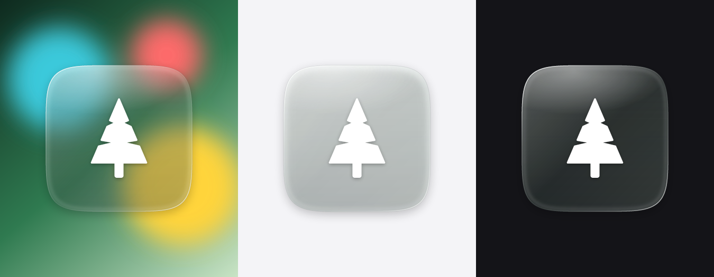
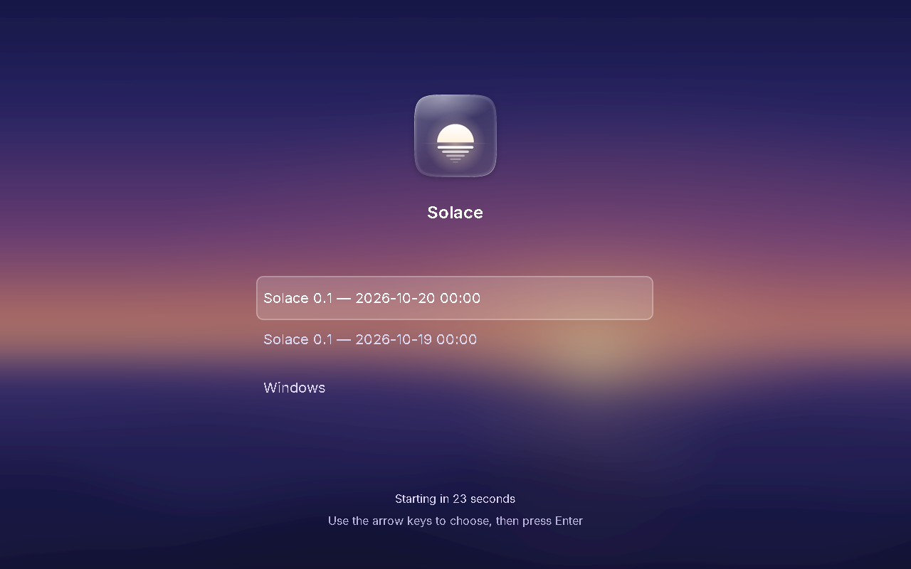

# Koi Human Interface Guidelines

**Status: outline only.** The values below are the fixed starting points
from CLAUDE.md. Everything marked *(Phase 6)* is defined, implemented in
`de/design/`, and documented with screenshots in Phase 6. The GRUB theme
(Phase 2) uses the palette and type from here.

## Principles

1. **Calm.** Few colors, generous space, motion that settles and doesn't
   bounce for attention.
2. **Consistent.** Every surface comes from the shared design-system
   module; no app styles its own controls.
3. **Ours.** Original art and permissively licensed fonts and symbols
   only. Nothing from Apple, and no upstream Linux branding.
4. **Invisible plumbing.** The user never sees the Linux underneath: no
   terminal flashes, unthemed dialogs, or raw error text.

## Foundations

| Area | Fixed now | To define *(Phase 6)* |
|---|---|---|
| Spacing | 4 px grid | named steps |
| Type | Inter (UI), JetBrains Mono (mono) | size/weight/leading scale |
| Symbols | Phosphor or Lucide, plus our own | final choice + sizes |
| Icon shape | continuous-curvature squircle (superellipse) | exponent, sizes |
| Color | light + dark palettes + accent; every pair passes WCAG AA | tokens, contrast table |
| Materials | window, sidebar, popover, menu, HUD, sheet = blur + tint + noise | blur radii, tint alphas |
| Radii | | window, control, popover radii; corner style presets |
| Motion | critically damped springs, never fixed durations | spring presets; reduce-motion mapping |

## Controls *(Phase 6)*

Buttons, toggles, checkboxes, segmented controls, sliders, steppers, text
fields, search fields, popovers, sheets, alerts, menus, sidebars, toolbars
with unified titlebars, tables, outline views, column views.

## Windows *(Phase 5)*

Traffic-light buttons top-left (close / minimize / zoom), glyphs on hover,
dimmed when inactive; shadows tied to focus.

## Brand

The Solace logo is a sun settling into still water at dusk: calm, warm,
and the "sol" in the name. Generated by `tools/brand/gen-logo.py`
(`just logo`); never edit the SVGs by hand.

| Asset | Use |
|---|---|
| `assets/brand/solace-icon.svg` | full-colour icon: About, installer, docs, app-store style contexts |
| `assets/brand/solace-mark.svg` | single colour (`currentColor`): menu bar Solace menu, boot splash, GRUB theme |
| `assets/brand/solace-icon-glass.svg` | clear glass on a transparent background: over wallpapers and translucent surfaces; the reference look for the "Clear" icon mode |

**Glass.** The glass plate is mostly transparent (a white body at 7-26%
opacity, brighter toward the light), with a rim light on the top-left and
bottom-right edges, a top sheen, a soft inner band for thickness, and a
faint dark hairline outside the rim so the edge holds on white. The
foreground is white with a soft shadow. A standalone SVG cannot blur its
backdrop; on screen the compositor supplies the backdrop blur.

**Squircle.** Every icon plate is the superellipse
`|x/a|^5 + |y/a|^5 = 1` (continuous curvature, no visible join where the
edge meets the corner). The plate is 824 units on a 1024 canvas, leaving
room for the shadow (y +14, blur 22, 32% black). This definition moves to
`de/design` in Phase 6 and both must stay identical.

**Mark grid.** The mark is drawn on a 64-unit canvas with every edge on a
4-unit grid, so it renders pixel-sharp at 16 px (menu bar) and at every
multiple of 16.

**Logo palette** (starting point for the design-system palette, Phase 6):

| Role | Hex |
|---|---|
| Night (sky top) | `#16184A` |
| Dusk violet | `#3A3088` |
| Rose | `#B05C8E` |
| Horizon coral | `#F7A072` |
| Sun light | `#FFF4D2` |
| Sun gold | `#FFD58C` |
| Sun ember | `#FFAA5C` |
| Deep water | `#121338` |

## Boot menu

Our GRUB gfxmenu theme (`boot/grub-theme/`, `just grub-preview` boots it
in QEMU and screenshots it): the blurred Dusk wallpaper, the glass logo
and name, a centred list in Inter 20 with a translucent rounded
highlight, and a countdown and hint line in Inter 16. GRUB's own title
and help text never appear. With the default menu style ("hidden") none
of this shows unless Shift is held.
